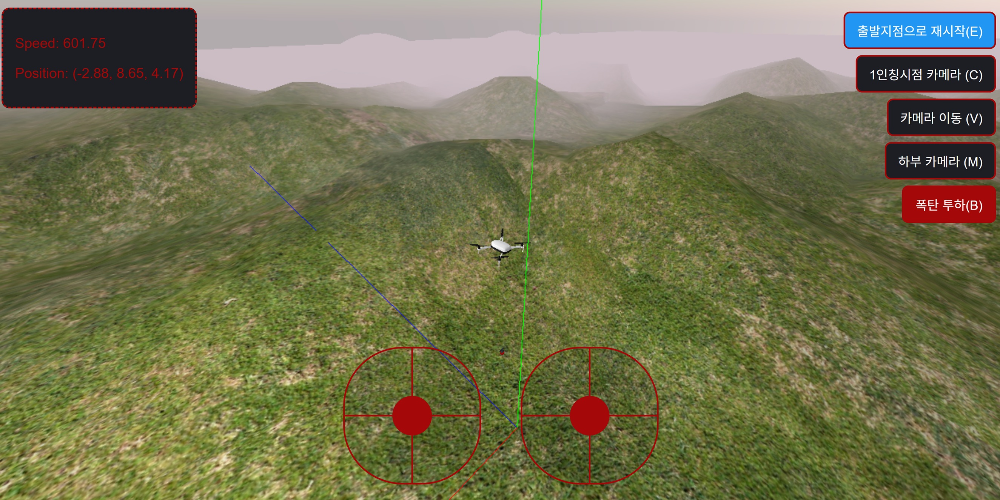

# 웹 기반 드론 시뮬레이션

## 안드로이드 앱의 WebSocket 데이터 또는, 마우스클릭+드래그로 기반으로 드론의 움직임을 제어

## 작업 정보

- VS-Code기반 코파일럿AI 에이전트 개발환경 사용
- 현재 기존 조이스틱에서 마우스+드래그 기반으로 드론 움직임 제어방식을 변경 OK. (https://github.com/kimilguk/WebBaseDroneSimulation)
- WebSocket 데이터로 드론 움직임 제어방식을 사용하는 안드로이드 앱은 제작 OK. (https://github.com/kimilguk/SocketDroneSimulation)

## 컨트롤러 정보

- E 버튼을 누르면 출발 지점으로 재시작.
- C 버튼을 누르면 카메라가 1인칭시점 카메라로 전환됩니다.
- M 버튼을 누르면 카메라가 폭탄을 비추는 드론 카메라2로 전환됩니다.
- V 1인칭시점일 때만 카메라 이동이 가능하고, 카메라 이동 중에는 드론이 멈춤니다.
- B 버튼을 누르면 폭탄이 투하됩니다.

# Three.js 기반 드론 시뮬레이션

이 저장소에는 3D 드론 환경을 시뮬레이션하는 Three.js 프로젝트가 포함되어 있습니다. 이 프로젝트는 최신 웹 기술을 활용하여 사실적이고 상호작용 가능한 드론 시뮬레이션을 구현합니다. 또한, 웹 브라우저에서 3D 그래픽을 렌더링하는 Three.js의 역량을 잘 보여주는 훌륭한 사례입니다.

## 특징

- 사실적인 3D 드론 모델
- 드론 조종을 위한 인터랙티브 컨트롤
- 하늘, 조명, 지형을 조정할 수 있는 역동적인 환경
- Three.js를 활용한 실시간 렌더링

## 시작하기

이 프로젝트를 로컬 환경에서 실행하려면 다음 단계를 따르세요:

1. 리포지토리를 로컬 머신으로 복제(clone)합니다.
2. Node.js가 설치되어 있는지 확인합니다.
3. 의존성 패키지를 설치합니다: `npm install`
4. 서버를 시작합니다: `node server.js`
5. 웹 브라우저를 열고 `http://localhost:8080/`에 접속합니다.

## 웹소켓 제어

제어 클라이언트를 `ws://localhost:8080/`에 연결하고, `roll`, `pitch`, `yaw`, `throttle`, `leftSwitch`, `gear`라는 숫자형 속성을 포함하는 JSON 텍스트 메시지를 전송하십시오. 서버는 유효한 각 메시지를 브라우저 시뮬레이션으로 전달합니다. 제어 값은 `-128`에서 `255` 사이여야 합니다. 예시:

```json
{"roll":0,"pitch":0,"yaw":0,"throttle":0,"leftSwitch":0,"gear":0}
```

화면에 표시된 가로 및 세로 조이스틱은 마우스로 클릭하고 드래그하여 드론을 조종할 수 있습니다. 왼쪽 조이스틱은 좌우회전(요-yaw)와 상승/하강(스로틀-throttle)을 제어하며, 오른쪽 조이스틱은 좌우이동(롤-roll)과 전진/후진(피치-pitch)를 제어합니다. 마우스에서 손을 떼면 조종 장치는 중립 위치로 돌아갑니다. 
일반적으로, leftSwitch는 비행모드 On/Off ,gear 는 프로펠러 회전속도로 알려져 있으나, 실제는 다른 용도로 사용됩니다.(아래)
- leftSwitch(폭탄 투하 상태) : -1이면 폭탄을 투하하고 애니메이션을 시작합니다. 0이면 투하 상태를 해제해 폭탄이 드론에 다시 붙습니다.(키보드의 B)
- gear(카메라 모드 선택) : 특정 값 범위에 따라 드론 카메라, 하부 카메라로 전환합니다.(키보드 C-1인칭시전, M-폭탄비추기, V-카메라 이동).
- E(출발 지점으로 재시작) : 별도의 전송 값으로 받습니다.

## 코드 개요

코드의 주요 구성 요소는 다음과 같습니다:

- **드론 모델 로딩**: GLTFLoader를 사용하여 3D 드론 모델을 불러옵니다.
- **환경 설정**: 역동적인 하늘, 태양 위치 설정, 그리고 사실적인 지형을 구현합니다.
- **드론 제어**: 외부 안드로이드 앱의 WebSocket 데이터 또는, 마우스클릭+드래그로 기반으로 드론의 움직임을 제어합니다.
- **렌더링 루프**: 업데이트된 드론 위치와 환경 설정을 반영하여 장면을 지속적으로 렌더링합니다.




## 원본 깃 허브 정보

조이스틱을 사용하는 원본소스: [Bomb animation play speed changes with dron's y location.](https://github.com/civanahmetyasin/WebBaseDroneSimulation.git)
